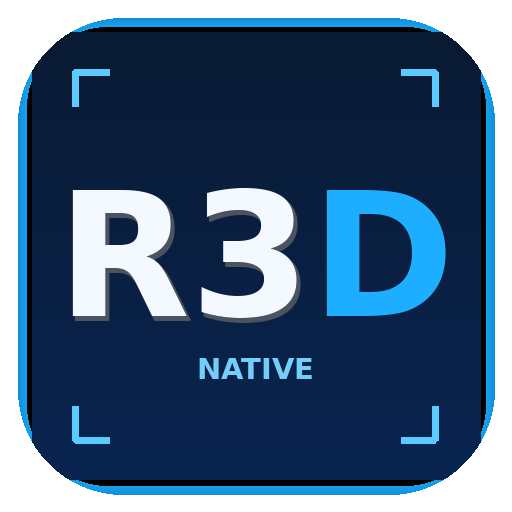

<div align="center">
  
  <h1>ReNative3D36S</h1>
  <p><b>Interface Windows para recompilar jogos Nintendo 3DS para o R36S com Pocket Native e gerenciar motores experimentais.</b></p>
  <p>
    <a href="LICENSE"></a>
    <a href=".github/workflows/windows-build.yml"></a>
    <a href="https://github.com/CarvalhoRonan/ReNative3DS/releases"></a>
  </p>
  <p><a href="docs/TUTORIAL-PT-BR.md">📖 Tutorial em português</a> · <a href="docs/USER-GUIDE-EN.md">English guide</a> · <a href="docs/MOTORES-PT-BR.md">Motores suportados</a> · <a href="https://github.com/CarvalhoRonan/ReNative3DS/releases">Baixar / Releases</a></p>
</div>

> [!WARNING]
> **Versão de testes v0.2.0-beta.1.** O código-fonte é público, mas esta revisão não foi validada completamente em um R36S real. O adaptador Zakuro, a seleção de motores e a interface atual precisam de testes adicionais. **Não distribua arquivos produzidos a partir de ROMs comerciais.**

## O que é

O **ReNative3D36S**, desenvolvido pela **Overclock Informática**, é uma interface independente, feita em **C# / WPF / .NET 10**, que automatiza o uso do [Pocket Native](https://github.com/whovian64/pocket-native) no Windows. O projeto **não** contém emuladores proprietários, ROMs, chaves de consoles ou jogos. O resultado da recompilação para o R36S é um conjunto de executáveis/bibliotecas ARM64 e um lançador `.sh`, não um jogo Windows.

**Recursos do código-fonte v0.2.0:** interface azul-escura com logotipo R3D, seleção de ROM e destino, logs, progresso por etapas, quatro idiomas (Português, English, Español, Русский), consulta de atualizações do Pocket Native, saída organizada por jogo, biblioteca local, tela Sobre/Apoiar e seletor de motores. O menu suspenso recebeu correção de contraste nesta revisão.

## Baixar e compilar no Windows

**[➡️ Releases e downloads](https://github.com/CarvalhoRonan/ReNative3DS/releases)** · [Todos os arquivos do projeto](https://github.com/CarvalhoRonan/ReNative3DS)

1. Na página de **Releases**, baixe **Source code (zip)**. Você também pode baixar o ZIP em **Code → Download ZIP**.
2. Extraia em uma pasta local, por exemplo `C:\Projetos\ReNative3D36S`. Evite pastas sincronizadas pelo OneDrive durante a compilação.
3. Dê dois cliques em **`COMPILAR-UM-CLIQUE.cmd`**. O script localiza ou instala um SDK **.NET 10** na pasta `.tools`, restaura pacotes NuGet e publica o programa Windows x64.
4. Aguarde terminar. Abra **`dist\portable\ReNative3D36S.exe`**.
5. Se o release oferecer também **`ReNative3D36S-Windows-x64-TESTE.zip`**, ele é um binário experimental gerado pelo GitHub Actions. Isso depende do sucesso do build no Windows e **não significa compatibilidade validada com todas as ROMs**.

Consulte o [tutorial completo em português](docs/TUTORIAL-PT-BR.md) ou o [English guide](docs/USER-GUIDE-EN.md).

## Para recompilar uma ROM para o R36S

1. **Abra o Docker Desktop** e aguarde o motor ficar pronto (*Engine running*). Conclua a instalação do WSL2 e reinicie o Windows se necessário.
2. **Permita o acesso à pasta da ROM e ao diretório de destino**, caso o Docker peça permissão. Isso é especialmente importante para unidades adicionais, como `D:` e `E:`. Dependendo da configuração WSL2, o menu **Settings → Resources → File Sharing** pode não aparecer.
3. Abra o ReNative3D36S, selecione **Pocket Native Oficial**, uma ROM `.3ds`/`.cci` descriptografada de sua propriedade ou `.cia` compatível, e a pasta de saída. Arquivos CIA podem exigir `aes_keys.txt` extraído do seu console.
4. Clique em **Iniciar recompilação**, acompanhe as etapas e consulte os logs caso algo falhe.
5. Na saída, copie **a pasta nomeada pelo jogo E seu `.sh` correspondente**, lado a lado, para `roms/ports` ou `roms2/ports` no cartão de jogos. Reinicie o EmulationStation.

```text
Recomps/
├── Pokémon Omega Ruby/
│   └── pocket-native/
│       ├── pocket-native
│       ├── run.sh
│       └── games/<title-id>/...
└── Pokémon Omega Ruby.sh       ← copiar junto com a pasta do jogo
```

**Se houver problemas**, leia também as instruções do projeto original: [Pocket Native README](https://github.com/whovian64/pocket-native), [START_HERE.md](https://github.com/whovian64/pocket-native/blob/master/START_HERE.md) e [compatibilidade/perfis](https://github.com/whovian64/pocket-native/blob/master/docs/games.md).

## Motores e situação de funcionamento

| Motor | Situação na v0.2.0 | Saída |
|---|---|---|
| **Pocket Native Oficial** | Integração principal existente; exige Docker e ROM compatível. Ainda precisa de teste completo desta revisão. | R36S / ArkOS / ARM64 |
| **Fork local compatível** | Adaptador experimental que usa uma pasta escolhida pelo usuário; compatibilidade não garantida. | R36S / Linux ARM64 |
| **Zakuro + 3dsrecomp** | Adaptador experimental que chama a ferramenta Windows externa instalada separadamente. Precisa de Zakuro e compilador C. | Windows / runtime Zakuro |
| **ReNative Optimized** | **Não desenvolvido. Opção desabilitada.** | Planejado para R36S |

Não misture versões e não assuma que trocar o motor atualiza um jogo já compilado. Veja [instruções e limitações dos motores](docs/MOTORES-PT-BR.md).

## Tutoriais e desenvolvimento

- [Tutorial completo, requisitos, Docker, instalação no R36S e solução de problemas](docs/TUTORIAL-PT-BR.md)
- [Guia de motores selecionáveis e seus estados](docs/MOTORES-PT-BR.md)
- [English: build and use](docs/USER-GUIDE-EN.md)
- [Notas desta pré-versão](docs/RELEASE-NOTES-v0.2.0-beta.1.md)
- [Como contribuir](CONTRIBUTING.md) · [Segurança](SECURITY.md) · [Privacidade](PRIVACY.md)
- [Compilação automatizada no GitHub Actions](.github/workflows/windows-build.yml)

## Links e apoio à Overclock Informática

| Instagram | Página de links | Pix (Brasil) | Ko-fi |
|:--:|:--:|:--:|:--:|
| <a href="https://www.instagram.com/oc.informatica/"></a> | <a href="https://linkme.bio/overclockinformatica"></a> |  | <a href="https://ko-fi.com/overclockinformatica"></a> |
| [Instagram](https://www.instagram.com/oc.informatica/) | [Todos os links](https://linkme.bio/overclockinformatica) | Confira o beneficiário antes de transferir | [Apoiar pelo Ko-fi](https://ko-fi.com/overclockinformatica) |

O apoio é **voluntário** e não desbloqueia funções. Não é necessário pagar para usar ou compilar o projeto.

## Créditos, direitos e licenças

A **interface própria do ReNative3D36S** é disponibilizada sob **MIT** ([LICENSE](LICENSE)). Mantemos os créditos dos projetos originais: [Pocket Native](https://github.com/whovian64/pocket-native), mantido por **whovian**, derivado de [Zakuro](https://github.com/fearkov/zakuro) e [3dsrecomp](https://github.com/fearkov/3dsrecomp), desenvolvidos por **fearkov**. As licenças desses projetos e demais dependências continuam válidas independentemente da licença da nossa interface. Veja [THIRD_PARTY_NOTICES.md](THIRD_PARTY_NOTICES.md) e [`licenses/`](licenses/).

**ScarletNX e Azahar são apenas referências tecnológicas**, não motores de 3DS prontos integrados ao aplicativo. Não somos afiliados à Nintendo, aos autores do Pocket Native nem a outros projetos. ROMs, chaves privadas, saves e dumps de firmware **não são distribuídos** neste repositório. Respeite os direitos dos desenvolvedores e os direitos autorais dos jogos.

---

<small>Experimental / independent community project · <a href="https://github.com/CarvalhoRonan/ReNative3DS/issues">Reportar problema</a> · <a href="https://github.com/CarvalhoRonan/ReNative3DS/releases">Releases</a></small>
